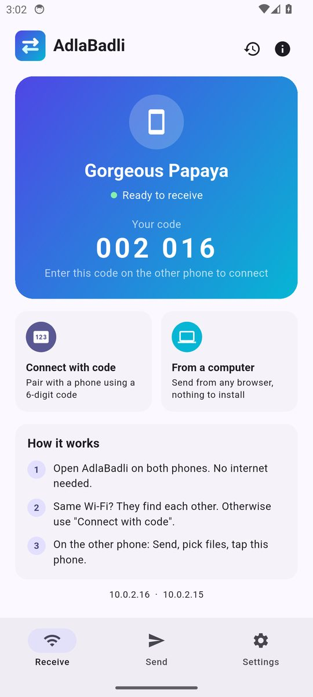
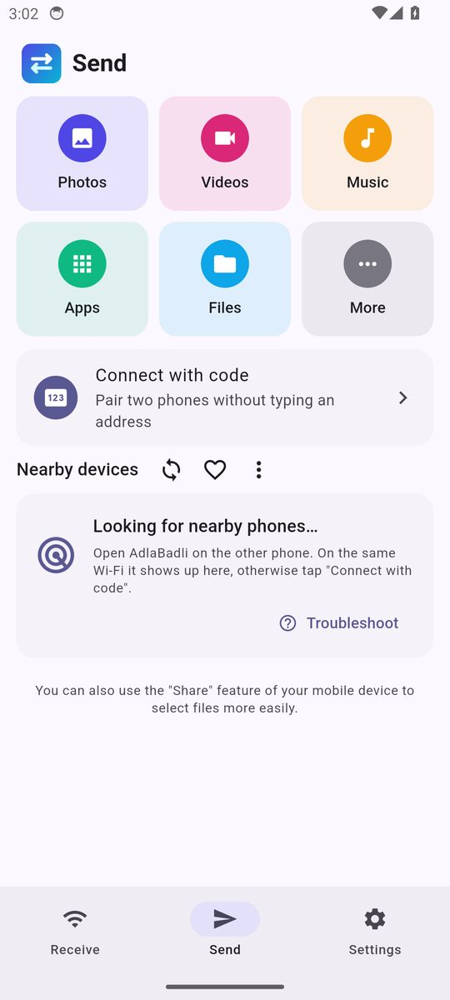
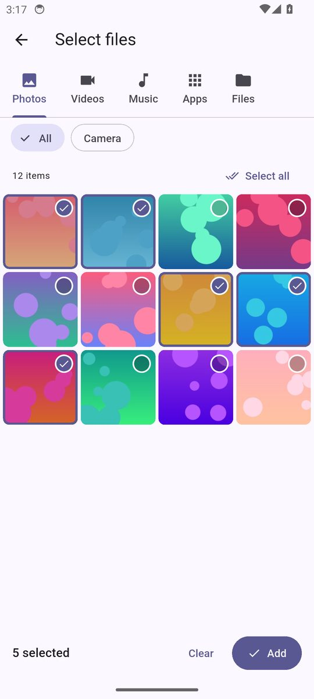
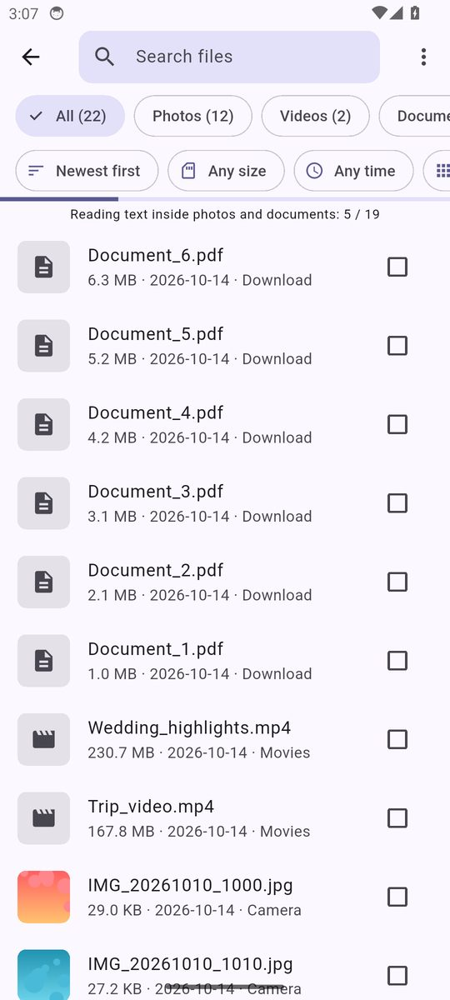
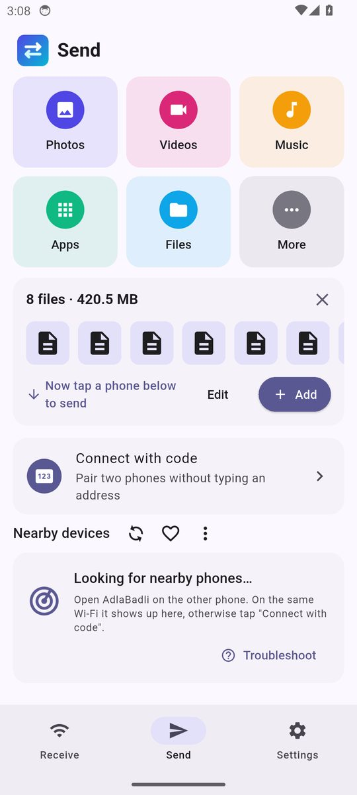
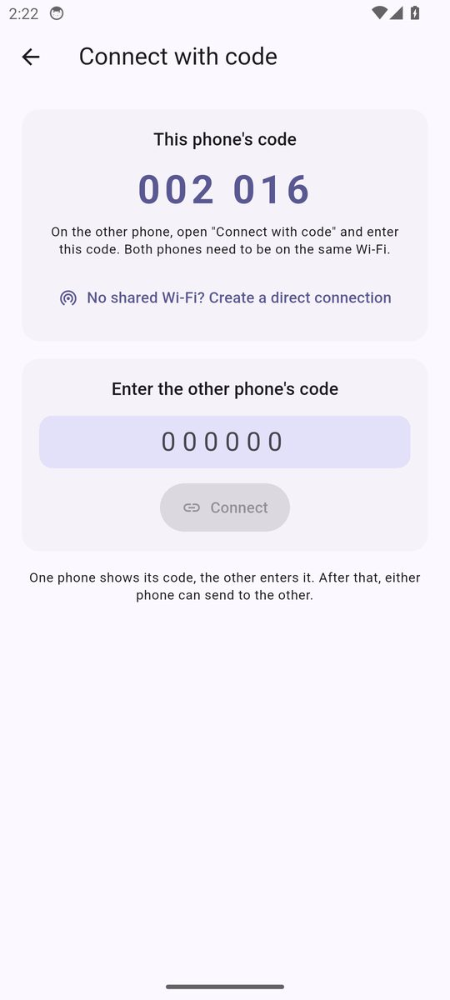
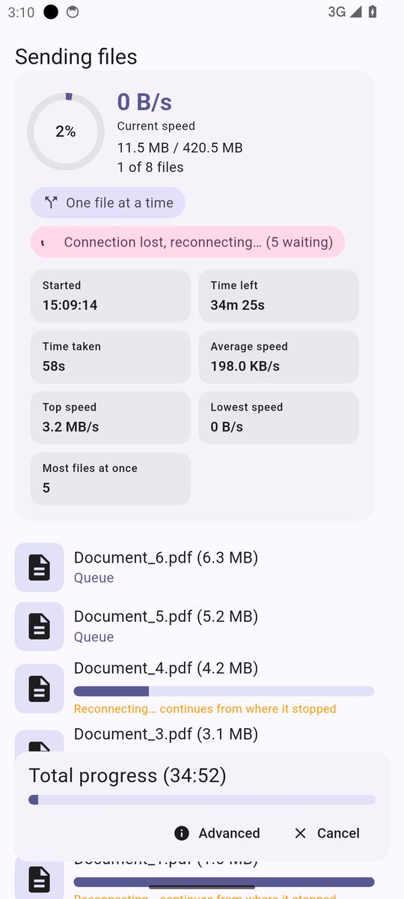
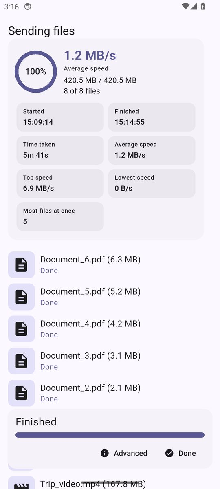
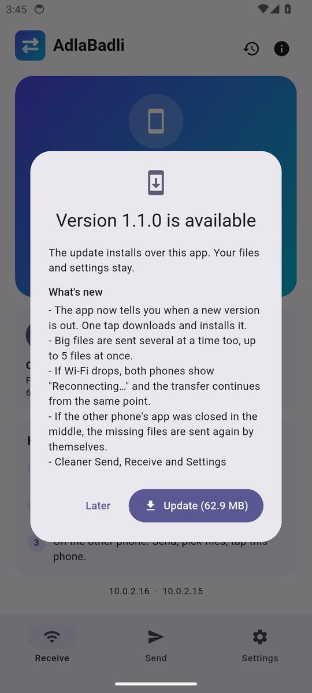

  

<h1 align="center">AdlaBadli</h1>

  Send photos, videos, apps and files between phones and computers that are near each other. 
  Fast, without internet, and without cables.

  <a href="../../releases/latest"><b>⬇ Download the latest version</b></a>

---

## Download

Open the [latest release](../../releases/latest) and download the file for your phone:

| File | For |
|---|---|
| `AdlaBadli-…-arm64.apk` | **Most Android phones** (2017 and newer). Pick this one if you are unsure. |
| `AdlaBadli-…-arm32.apk` | Older or budget Android phones that cannot install the arm64 file. |
| `AdlaBadli-…-x86_64.apk` | Chromebooks and Android emulators on a PC. |

**Install:** open the downloaded `.apk` file on your phone. If Android asks, allow "Install unknown apps" for your browser or file manager. Install it on both phones.

**Updates:** from version 1.1.0 on, the app tells you when a new version is out. Tap **Update** and confirm the installation. Your files and settings stay.

## Screenshots

| Receive | Send | Pick photos |
|---|---|---|
|  |  |  |

| All files, with search | Ready to send | Connect with a code |
|---|---|---|
|  |  |  |

| Connection lost? It reconnects | Finished, with speed and time | Update in the app |
|---|---|---|
|  |  |  |

## How to use

**Send:** open **Send**, tap **Photos**, **Videos**, **Music**, **Apps** or **Files**, select and tap **Add**. Then tap the other phone in the list. To send whole folders, open **Files → Browse folders** and tick them.

**Pause:** tap **Pause** on the transfer screen and **Resume** later. It continues from where it stopped.

**Send again:** **Send → History** (clock icon) lists every transfer. For one that failed or was cancelled, tap **Send the rest**.

**Receive:** keep AdlaBadli open on **Receive** and accept the request.

**The other phone is not in the list?** Open **Connect** on both phones and tap **Scan the other phone's QR code** on one of them, or type the 6-digit code of one phone into the other. Without any Wi-Fi, tap **Create a direct connection** (Wi-Fi Direct, also the fastest way).

**Shared a link?** When someone opens a link from **Share via link** on an Android phone with AdlaBadli, the page offers **Open in the AdlaBadli app**, which downloads the files inside the app.

**From a computer:** on the phone open **Receive → From a computer** and open the address it shows in any browser. Drag files or folders into the page.

## What it does

- Sends up to 5 files at once, big and small together, and shows the ones moving right now on top.
- Pause and resume, and a history to send failed or cancelled transfers again.
- Sends installed apps completely, also Play Store apps made of several APK files (as one `.apks` file that AdlaBadli installs).
- Connect with a QR code, a 6-digit code, or directly without Wi-Fi (Wi-Fi Direct).
- Continues from the same point when Wi-Fi drops. No need to select the files again.
- Shows current, average, top and lowest speed, start and end time, and how many files move at once.
- Keeps running in the background with the screen off.
- No internet needed. Everything stays between your devices and is sent encrypted.

---

This repository only holds the app downloads. AdlaBadli is based on [LocalSend](https://github.com/localsend/localsend) (Apache License 2.0).
